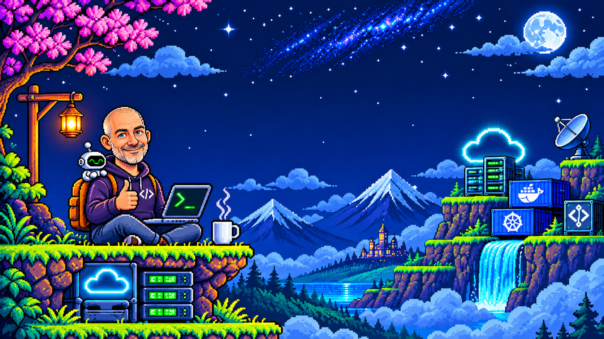

<!-- Original retro pixel-art hero. Keep assets/pixel-cloud-quest.png in this repository. -->

<!-- Animated terminal-style rotating headline. -->

# Hey, I'm iamenr0s 👾

### Senior Cloud Platform Engineer · Automation Enthusiast

**I build the platforms behind great products — and the products that prove those platforms work.**

From thoughtful interfaces and resilient APIs to cloud-native infrastructure, AI-enabled workflows, and observable production systems. I care about making complex engineering feel simple, repeatable, and dependable.

Engineering for the long run. ⚡

---

## ⚡ What I build

| Area | What matters |
| :--- | :--- |
| **Full-stack engineering** | Accessible, fast frontends and well-designed APIs that solve real problems. |
| **Cloud-native platforms** | Containerized workloads, Kubernetes ecosystems, infrastructure as code, and developer-friendly foundations. |
| **AI & intelligent automation** | Practical AI integrations, workflow orchestration, and tools that remove repetitive work. |
| **GitOps & delivery** | Declarative environments, version-controlled changes, repeatable deployments, and safe release workflows. |
| **Data & observability** | Dependable data flows, useful telemetry, actionable alerts, and systems that are easier to understand under pressure. |

## 🧰 Engineering toolbox

A cross-disciplinary toolkit — the technologies below represent areas of focus, not a claim of equal depth in every tool.

**Frontend & experience**

**Backend & APIs**

**Cloud, containers & GitOps**

**AI, data & observability**

---

## 🧭 How I work

| Principle | In practice |
| :--- | :--- |
| **Clarity over cleverness** | Make intent obvious in code, architecture, documentation, and decisions. |
| **Simplicity by design** | Prefer the smallest solution that reliably meets the need — and can evolve later. |
| **Ownership end to end** | Think beyond the merge: delivery, security, operations, maintenance, and user impact. |
| **Automation with purpose** | Automate repeatable work, keep humans in control, and make the safe path the easy path. |
| **Observe, learn, improve** | Use feedback and production signals to drive pragmatic iteration. |

## 🔭 Areas I'm exploring

- **AI-assisted engineering:** Claude-powered development, retrieval patterns, and reliable AI-enabled workflows.
- **Platform as a product:** paved roads, self-service tooling, and a better developer experience.
- **Progressive delivery:** GitOps, policy, automated checks, and safer changes.
- **Operational excellence:** meaningful SLOs, actionable observability, and graceful failure.

## 📌 Selected work

A selection of projects spanning container engineering, security, infrastructure automation, and practical software:

- **[multi-arch-images-v2](https://github.com/iamenr0s/multi-arch-images-v2)** — multi-architecture container image builds and workflows.
- **[docker-hardened-images](https://github.com/iamenr0s/docker-hardened-images)** — security-focused container images and hardened build foundations.
- **[docker-ansible-images](https://github.com/iamenr0s/docker-ansible-images)** — containerized Ansible tooling for repeatable infrastructure automation.
- **[Lanwarden](https://github.com/iamenr0s/lanwarden)** — software project exploring practical application engineering.

[**Explore all repositories →**](https://github.com/iamenr0s?tab=repositories)

---

### Let's build things that last.

**Good engineering is invisible when everything works — and invaluable when it doesn't.**

Built with curiosity · Shipped with care · Improved continuously

